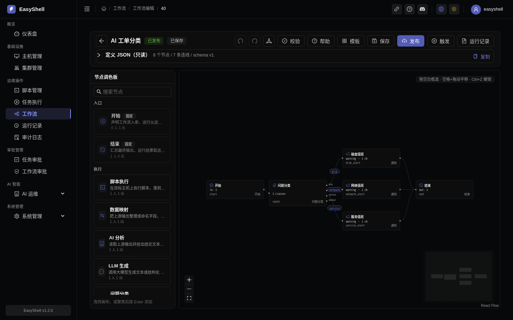

<p align="center">
  
</p>

# EasyShell

**AI-Native Server Operations Platform**

Let AI write your scripts, orchestrate multi-host tasks, and analyze your infrastructure — while you focus on what matters.

[](./LICENSE)
[](https://docs.easyshell.ai)
[](https://discord.gg/akQqRgNB6t)

**Language**: English | [简体中文](./README.zh-CN.md) | [繁體中文](./README.zh-TW.md) | [한국어](./README.ko.md) | [Русский](./README.ru.md) | [日本語](./README.ja.md)

---

## Why EasyShell?

Traditional server management tools expect you to write every script, SSH into every box, and interpret every output yourself. EasyShell flips that model: **AI is the operator, you are the decision-maker.**

- **Describe what you need in plain language** → AI writes production-ready shell scripts with diff review
- **Set a goal across multiple hosts** → AI plans the execution steps, runs them, and synthesizes the results
- **Schedule automated inspections** → AI analyzes output and decides whether to alert your team via bot channels
- **Connect via Web SSH** → Full terminal with file manager, multi-tab, search — no local client needed

---

## Core Features

### 1. AI Script Assistant

> Describe what you want. AI writes the script. Review the diff. One click to apply.

The AI Script Workbench is a split-panel editor where you describe requirements in natural language, and AI generates (or modifies) shell scripts targeting your chosen OS. Real-time streaming shows the script being written. A built-in diff view highlights exactly what changed. A summary tab explains the modifications in your language.

<p align="center">
  
</p>

**How it works:**
1. **Describe** — write your requirements in natural language, choose the target OS
2. **Generate** — AI streams a production-ready script in real time
3. **Review** — built-in diff view highlights every change; summary tab explains modifications
4. **Apply** — one click to save the script to your library or dispatch it immediately

### 2. AI Task Orchestration

> "Check disk and memory on all hosts, flag anything over 80%, and suggest fixes." — Done.

The AI Chat interface lets you issue high-level operational goals. AI decomposes them into a multi-step execution plan (explore → analyze → report), dispatches scripts to target hosts, collects results, and delivers a structured analysis with risk assessment and actionable recommendations — all in a single conversation turn.

<p align="center">
  
</p>

**How it works:**
1. **Instruct** — describe a high-level goal in the AI Chat (e.g. "check disk on all hosts")
2. **Plan** — AI decomposes the goal into a multi-step execution plan (explore → analyze → report)
3. **Execute** — scripts are dispatched to target hosts in parallel; results collected automatically
4. **Report** — AI delivers a structured analysis with risk assessment and actionable recommendations

### 3. AI Scheduled Inspections

> **Cron → Script → AI Analysis → Intelligent Alert** — AI analyzes output and decides whether to alert your team.

Schedule inspection tasks with cron expressions and select scripts from the built-in script library. EasyShell dispatches them to agents on schedule, collects output (disk, memory, services, logs), sends it to your AI model for intelligent analysis, and **lets AI decide whether the results warrant an alert** — pushing notifications only when they matter.

<p align="center">
  
</p>

**How it works:**
1. **Configure** — cron expression + script (from library or custom) + AI analysis prompt + notification rules
2. **Execute** — EasyShell dispatches to target agents on schedule
3. **Analyze** — Output sent to AI model (OpenAI / Gemini / GitHub Copilot / Custom) for intelligent analysis
4. **Notify** — AI determines severity and pushes alerts via bot channels when action is needed

**Notification modes:** Always push, push on failure, push on warning, or **AI decides** — the AI model evaluates the output and autonomously determines if an alert is necessary.

**Supported Bot Channels** ([Configuration Guide](https://docs.easyshell.ai/configuration/bot-channels/)):

| Bot | Status |
|-----|--------|
| [Telegram](https://docs.easyshell.ai/configuration/bot-channels/) | ✅ Supported |
| [Discord](https://docs.easyshell.ai/configuration/bot-channels/) | ✅ Supported |
| [Slack](https://docs.easyshell.ai/configuration/bot-channels/) | ✅ Supported |
| [DingTalk (钉钉)](https://docs.easyshell.ai/configuration/bot-channels/) | ✅ Supported |
| [Feishu (飞书)](https://docs.easyshell.ai/configuration/bot-channels/) | ✅ Supported |
| [WeCom (企业微信)](https://docs.easyshell.ai/configuration/bot-channels/) | ✅ Supported |

### 4. Fully Functional Web SSH

> Real terminal. Real file manager. No SSH client required.

A production-grade web terminal with multi-tab sessions, integrated file manager (upload, download, create, delete, navigate), full-text search within terminal buffer, and persistent connections via WebSocket. Manage files and run commands side by side.

<p align="center">
  
</p>

### 5. Host Management & Monitoring

> Unified view of all servers with real-time status, batch operations, and agent lifecycle management.

Manage hosts individually or in bulk — add via form or CSV import, organize into clusters, monitor connection status, and deploy/upgrade agents with one click. The unified dashboard shows health metrics at a glance.

<p align="center">
  
</p>

### 6. Real-Time Streaming Logs

> Watch script execution unfold live across all target hosts.

When you dispatch a script, EasyShell streams output from every agent in real time. Color-coded logs, timestamps, and per-host filtering help you spot issues instantly — no more waiting for batch jobs to complete.

<p align="center">
  
</p>

### 7. Security & Risk Controls

> Built-in safeguards: approval workflows, audit trails, and operation restrictions.

Configure which operations require approval before execution. All actions are logged for compliance. Role-based access control limits who can do what, and sensitive commands can be flagged or blocked entirely.

<p align="center">
  
</p>

### 8. MCP Server & AI Skills

> Let your AI client run your infrastructure — with the same risk engine, approvals and audit trail as the web console.

EasyShell ships two companion components that put the platform *inside* your AI assistant:

- **`easyshell-mcp`** — a [Model Context Protocol](https://modelcontextprotocol.io) server that exposes EasyShell hosts, scripts, tasks and inspections as MCP **tools**, so Claude Desktop, Claude Code, Cursor, Cherry Studio and other MCP clients can drive EasyShell directly.
- **`easyshell-skill`** — a `SKILL.md` definition that teaches an assistant *when* and *how* to use EasyShell (core workflows, full tool catalog, security model), for assistants that support skills.

#### `easyshell-mcp` — EasyShell as MCP tools

Published on npm as [`@easyshell/mcp-server`](https://www.npmjs.com/package/@easyshell/mcp-server), listed in the [MCP Registry](https://registry.modelcontextprotocol.io/servers/io.github.easyshell/mcp-server) and on [Smithery](https://smithery.ai/server/@easyshell/mcp-server). It talks to the EasyShell REST API and needs three variables:

| Variable | Required | Description |
|---|---|---|
| `EASYSHELL_URL` | Yes | EasyShell server API endpoint (for example `http://localhost:18080`). |
| `EASYSHELL_USER` | Yes | EasyShell username. |
| `EASYSHELL_PASS` | Yes | EasyShell password. |

**How it works:**
1. **Run** — `npx -y @easyshell/mcp-server` on Node.js `>=18`; nothing to build
2. **Connect** — point it at your EasyShell server with the three variables above
3. **Authenticate** — it logs in against the EasyShell API and reuses that session for every tool call
4. **Operate** — your AI client calls EasyShell tools; risk classification, approval workflows and audit logging still apply

**stdio (default) — Claude Desktop / Claude Code / Cursor / Cherry Studio**

```json
{
  "mcpServers": {
    "easyshell": {
      "command": "npx",
      "args": ["-y", "@easyshell/mcp-server"],
      "env": {
        "EASYSHELL_URL": "http://localhost:18080",
        "EASYSHELL_USER": "easyshell",
        "EASYSHELL_PASS": "easyshell@changeme"
      }
    }
  }
}
```

> Replace the credentials with your own. With zero-configuration Docker deployment the initial admin password is generated randomly and printed once in the server logs (`docker logs easyshell-server | grep 'initial admin password'`).

Prefer not to hand-edit config files? The auto-installer detects OpenCode, Cursor or Claude Desktop and writes the block for you — the generated file is created with `0600` permissions because it holds your password:

```bash
MCP_PASSWORD='your-password' npx @easyshell/mcp-server --install
# optional: --url http://your-server:18080 --user easyshell
```

> `MCP_PASSWORD` is preferred over `--pass`: values passed on the command line are visible in `ps`.

**HTTP (SSE + Streamable HTTP) — remote or shared deployments**

```bash
# loopback only, no token required
npx -y @easyshell/mcp-server --port 3000

# reachable from other machines: a bearer token is mandatory
MCP_AUTH_TOKEN='choose-a-strong-token' \
  npx -y @easyshell/mcp-server --port 3000 --host 0.0.0.0 --allow-remote
```

| Endpoint | Method | Protocol |
|---|---|---|
| `/mcp` | POST / GET / DELETE | Streamable HTTP (2025-03-26) |
| `/sse` | GET | Legacy SSE (2024-11-05) |
| `/messages?sessionId=<id>` | POST | Legacy SSE message handler |
| `/health` | GET | Health check |

Clients with HTTP transport point at `http://<host>:3000/mcp` and send `Authorization: Bearer <MCP_AUTH_TOKEN>` (exact config keys vary by client):

```json
{
  "mcpServers": {
    "easyshell": {
      "type": "http",
      "url": "http://your-server:3000/mcp",
      "headers": { "Authorization": "Bearer <MCP_AUTH_TOKEN>" }
    }
  }
}
```

The HTTP transport validates the `Host` header against DNS-rebinding attacks, restricts CORS to `--allowed-origin` values, and caps sessions and request size.

**Tool surface — 20 tools in 3 tiers**

| Tier | Tools | Purpose |
|---|---|---|
| Core (6) | `list_hosts`, `get_host_detail`, `execute_script`, `get_task_detail`, `list_scripts`, `ai_chat` | Find hosts, run scripts, read results, drive AI orchestration |
| Management (9) | `list_recent_tasks`, `create_script`, `list_clusters`, `get_cluster_detail`, `get_dashboard_stats`, `get_host_metrics`, `list_scheduled_tasks`, `trigger_inspection`, `get_inspect_reports` | Day-to-day operations, monitoring and scheduled inspections |
| Advanced (5) | `manage_tags`, `query_audit_logs`, `approve_task`, `send_notification`, `search_knowledge` | Governance: tags, audit, approvals, notifications, knowledge base |

> The [`easyshell-mcp/README.md`](./easyshell-mcp/README.md) tool table advertises 19 tools; the source registers 20 — `get_cluster_detail` is missing from that table. The list above matches `easyshell-mcp/src/tools/`.

#### `easyshell-skill` — teach your assistant the EasyShell workflows

`easyshell-skill/SKILL.md` is an assistant-agnostic skill definition (name, description, compatibility, tags) that tells an AI assistant when to activate EasyShell and which workflows to follow — execute a script on hosts, AI task orchestration, schedule an inspection, monitor infrastructure — plus the security model it must never bypass.

Install it manually or with the `mdskills` CLI:

```bash
npx mdskills install easyshell
```

| Assistant | Skill path |
|---|---|
| OpenCode | `.opencode/skills/easyshell/SKILL.md` |
| Claude Code | `.claude/skills/easyshell/SKILL.md` |
| Cursor | `.cursor/skills/easyshell/SKILL.md` |
| VS Code Copilot | `.github/skills/easyshell/SKILL.md` |

The skill bundles `resources/tool-catalog.md` (every tool with parameters and examples), `resources/deployment-guide.md` and `resources/troubleshooting.md`. It works standalone, but **skill + MCP server** is the intended combination: the skill decides *what* to do, the MCP server provides the tools to do it.

#### Current boundary — read this before you plan a setup

`easyshell-mcp` is an **outbound** bridge: it makes EasyShell callable *from* your AI client. Consuming **external** MCP servers — Prometheus, Elasticsearch, or your own in-house MCP — *inside* the EasyShell platform is **on the roadmap, not implemented** in 1.1.0. There is no built-in MCP client, no external tool registry and no external-tool approval flow yet, and nothing in this section should be read as promising one.

If that is your use case, add it to the discussion in [issue #6](https://github.com/easyshell-ai/easyshell/issues/6) ("how do the mcp and skill modules work?"), or open a feature request.

### 9. Workflow Engine

> Drag your runbook onto a canvas. Pass values between nodes. Put a human gate in front of anything destructive.

The Workflow Engine turns a sequence of operational steps into a **visual, versioned, replayable-by-audit workflow**: a directed acyclic graph of nodes on an interactive canvas, where each node does one thing and hands its output to the nodes downstream. A run is triggered with typed inputs, executed by the same engine that already dispatches scripts to agents, and recorded node-by-node for audit.

<p align="center">
  
</p>

<!-- TODO(1.2.0 release): add docs/images/workflow-canvas.png. Suggested shot: the
     editor with a 4-node DAG on the canvas (one script-exec, one condition with
     both handles wired, one approval, one notify), the node palette on the left,
     the config form open on the right, and at least one node showing a run
     status colour. Dark theme, 1440x900. Remember: *.png is gitignored, so this
     file needs `git add -f`. -->

**How it works:**
1. **Compose** — drag nodes onto the canvas, wire them into a DAG, configure each one in the form panel
2. **Publish** — validation runs server-side; an ERROR blocks publishing, a WARNING only flags it
3. **Trigger** — provide typed run inputs, optionally with an idempotency key so a retry returns the same run
4. **Watch** — live node status, per-node input/output, durations, and the Task each `script-exec` produced

#### The five node types

| Node | What it does |
|------|--------------|
| `script-exec` | Runs a script on target hosts (explicit agents, a cluster, or a tag) — it lands on a real **Task**, so audit, live logs, the timeout watchdog and agent-disconnect handling are inherited rather than rebuilt |
| `condition` | Evaluates an expression (`nodes.check.output.usage > 90`) and writes the boolean to `output.result`; the **edge condition** — not the node — decides which branch is taken |
| `notify` | Pushes a rendered message to the bot channels you already configured (Telegram, Discord, Slack, DingTalk, Feishu, WeCom) |
| `approval` | Suspends the run and waits for an administrator to approve or reject, with a timeout, an optional mandatory comment, and an immutable detail snapshot |
| `wait` | Sleeps for `durationSec` (1–3600) and continues, checking for cancellation every 500 ms so a cancel is never stuck behind a sleep |

`approval` also has a `mode: "human-confirm"` configuration variant — a lighter "just confirm" gate that reuses the same approval row and the same suspend/resume state machine rather than adding a second mechanism.

#### How nodes talk to each other

Values travel along the edges through **three channels**:

- **Scalar variables** — run inputs (`run.input.<name>`), node outputs (`nodes.<key>.output.<path>`), and `outputVar` aliases. Values are visible only to a node's topological successors, snapshotted at the end of each scheduling wave into `workflow_run.variables_json`. A single value is capped at 8192 UTF-8 bytes; anything larger is stored as a head+tail preview with `truncated: true` plus a warning.
- **Artifact references** — **planned, not implemented**. 1.2.0 keeps the truncated preview instead of a dedicated artifact table.
- **Secrets** — **deliberately not implemented**. There is no `secret` variable type and no way to inject a credential into a script. The agent protocol only carries the script body, so a secret injected here would be written into the task's script column and printed by any `env`-like command. Until the agent has a side channel, secret injection is a decoration, not a feature. Structured data should go through JSON output; anything that must stay secret should stay in the host's own credential store.

Script interpolation is where the safety model earns its keep, because values arrive from remote hosts and are therefore untrusted. Four independent layers, each with its own tests:

1. **Value policy** — a whitelist character set (letters, digits, marks and an audited set of ASCII punctuation, ≤256 chars). Empty values, newlines and control characters are always refused.
2. **Reference rendering** — `{{NAME}}` renders as a **single-quoted** value, so `$`, backticks, `${}` and backslashes lose their meaning; `{{NAME:raw}}` renders the bare value and must be declared in `rawParams`.
3. **Segment-level substitution guard** — the rendered script is refused if a substituted value contains `$(`, a backtick or `${`; raw values additionally may not contain command-structure characters or start with `-`.
4. **The command risk gate** — the rendered script is assessed at the dispatch chokepoint, exactly like any other script.

Anything that *looks* like a slot but does not match the contract (`{{msg}}`, `{{MSG-X}}`) is refused outright, because the looser legacy substitution would otherwise run afterwards and undo layers 1–3.

**Honest limits**: a value containing shell structure characters (`; & | < > ( ) $ { }`) has no legal path in 1.2.0 — restructure the script instead. Passing a glob pattern is what `raw` exists for.

#### Failure policies

Each edge (and the definition as a whole) chooses what happens to a downstream node when an upstream one fails:

| Policy | Effect |
|--------|--------|
| `abort` | The node and everything not yet started is cancelled; the run ends `failed` |
| `skip` (default) | The node is marked `skipped` and its own downstream follows its own policy |
| `partial` | The node executes anyway, treating the failed upstream's output as absent |

When several incoming edges disagree, the **strictest** wins (`abort > skip > partial`). An unrecognised policy is treated as `abort` — the failure mode is closed, never open.

#### Approvals and the human in the loop

An `approval` node suspends the run **without holding a thread**: the approval row in the database is the single source of truth, the engine wakes the run on a decision (same-JVM event, plus a 10-second scanner as a backstop), and nothing depends on the browser that opened the run staying connected. That is why a run can stay `waiting` across a restart and be approved days later from another machine.

Two consequences worth knowing:

- **A high-risk script needs an approved `approval` ancestor.** The risk gate is the same chokepoint every script goes through; the one legal way past a non-LOW assessment is a human approval that is a topological ancestor of the `script-exec`. A workflow with no `approval` node cannot dispatch a HIGH script — under any `riskPolicy`.
- **Cancelling means "I am not waiting", not "it stopped".** An agent has no cancel message, so an already-dispatched job keeps running on the host and its result is discarded. The UI states this verbatim rather than hiding it in a tooltip.

#### The canvas

The editor is a full interactive canvas, not a read-only diagram:

- **Box selection** (drag on empty space), **alignment guides with snapping**, and **snap-to-grid** (20 px)
- **Undo / redo** (`Ctrl+Z` / `Ctrl+Shift+Z` / `Ctrl+Y`) covering structural edits, not just text
- **Minimap**, zoom controls, and **auto layout** (layered by depth, reusing the depth algorithm from the AI plan view — no layout library)
- **Copy / paste / duplicate** with key regeneration, so pasting a subtree yields a valid graph
- **Keyboard map**: `Delete` (with a confirmation listing what will be removed), `Ctrl+A`, `Ctrl+S`, arrow keys to nudge 20 px (4 px with `Shift`), `Enter` to open the selected node's config, `Esc` to close, `Space`+drag to pan

One rule holds the editor together: **the canvas is the only editor of structure, and the form is the only editor of a selected node's configuration**. With two write paths for the same definition, conflict handling and dirty tracking both become unsound — so the node palette can only add, never delete.

Connections are validated client-side (no self-loops, no duplicates, no cycles, no condition on a `condition` node's false branch) with the server remaining authoritative. Condition nodes get two output handles (`true` / `false`).

#### Monitoring and audit

The run detail page is a read-only canvas coloured by what actually happened, next to a node table with status, attempt count, duration, output, error and warning messages, and the linked Task. A variable panel shows the end-of-wave snapshot. Script output still streams over the task-log channel, per node.

Every run records enough to reconstruct what happened and why: the immutable definition version and its SHA-256, the full input snapshot, per-node input and output with their fingerprints, the attempt number, the Task id, the agent versions at dispatch time, and a snapshot of the risk rules in force when the run started. (Some of these — the agent-version snapshot, for instance — live in the database rather than the UI today.) High-risk events — publish, approve, reject, trigger, cancel — are audited synchronously, so a failed audit write fails the operation.

#### Current boundary — read this before you plan a setup

1.2.0 ships the engine and the editor. The following are **on the roadmap, not implemented**: cron and webhook triggers, the `parallel` / `ai-analyze` / `http-request` node types, dry-run, replay, the template market, artifact storage, secret injection, resume-after-restart for running runs, and fan-in variable merging. The single-node test-run endpoint exists on the server but is not surfaced in the UI yet. Run more than one server instance against the same database at your own risk: the engine is written for a single executor (the instance that starts a run is recorded on it), and there is no cross-instance lock yet.

See the [Workflow guide](https://docs.easyshell.ai/guides/workflow/) for a from-zero walkthrough, or open a feature request for what is missing.

---

## Quick Start

```bash
git clone https://github.com/easyshell-ai/easyshell.git
cd easyshell
docker compose up -d
```

That is the whole setup — **no `.env`, no secret generation, no manual steps**. On first
boot a one-shot container creates the database password, JWT secret, encryption key and
agent registration secret, stores them in the `easyshell_secrets` Docker volume and every
later start reuses them.

`scripts/deploy.sh` is a convenience wrapper that also waits for the health check and prints
the sign-in details:

```bash
./scripts/deploy.sh            # docker compose up -d + wait + show credentials
./scripts/deploy.sh --build    # build the images from this source tree instead of pulling
./scripts/deploy.sh --down     # stop everything (data volumes are kept)
```

No local build is required for the default path — pre-built images are pulled automatically
from [Docker Hub](https://hub.docker.com/u/laolupaojiao). Use `--build` to run exactly this
source tree (that is also how you pick up changes that have not been released yet).

Open `http://localhost:18880` → log in as `easyshell`. The initial password is generated
randomly on first start and printed once in the server logs
(`docker logs easyshell-server | grep 'initial admin password'`) — change it right after
signing in. To choose it yourself, set `EASYSHELL_ADMIN_PASSWORD` in `.env`.

Agents installed on other machines need a reachable server URL: set `PROVISION_SERVER_URL`
in `.env`, or **System config → server.external-url** in the UI.

> **Want to use GHCR instead?** Set in `.env`:
> ```
> EASYSHELL_SERVER_IMAGE=ghcr.io/easyshell-ai/easyshell/easyshell-server:latest
> EASYSHELL_WEB_IMAGE=ghcr.io/easyshell-ai/easyshell/easyshell-web:latest
> ```

> **Developer? Build from source:**
> ```bash
> docker compose -f docker-compose.build.yml up -d
> ```

Local web development and dependency checks require Node.js `^20.19.0 || >=22.12.0`, matching the Vite 8 toolchain. `Dockerfile.web` uses the Node 22 image line for web builds.

---

## Full Feature Set

| Category | Features |
|----------|----------|
| **AI Intelligence** | AI Script Assistant (generate / modify / diff / summary), AI Task Orchestration (multi-step plans, parallel execution, analysis), AI Scheduled Inspections (cron-based, AI output analysis, intelligent alert decisions, multi-channel bot push), AI Chat, Inspection Reports, Operation Approvals |
| **Operations** | Script library, batch execution, real-time streaming logs, Web SSH terminal with file manager, **Workflow Engine** (visual DAG canvas, node parameter passing, failure policies, human approvals, run monitoring) |
| **Infrastructure** | Host management, real-time monitoring, cluster grouping, agent auto-deployment |
| **Administration** | User management, system config, AI model settings (OpenAI / Gemini / Copilot / Custom), risk control |
| **Platform** | i18n (EN / ZH), dark/light theme, responsive design, audit logging |

---

## Architecture

```
┌──────────────┐       HTTP/WS        ┌──────────────────┐
│  EasyShell   │◄─────────────────────►│   EasyShell      │
│    Agent     │  register / heartbeat │     Server       │
│  (Go 1.24)  │  script exec / logs   │ (Spring Boot 3.5)│
└──────────────┘                       └────────┬─────────┘
                                                │
                                       ┌────────┴─────────┐
                                       │   EasyShell Web   │
                                       │ (React + Ant Design)│
                                       └──────────────────┘
```

## Tech Stack

| Component | Technology |
|-----------|-----------|
| Server | Java 17, Spring Boot 3.5, Gradle, JPA/Hibernate, Spring AI, Spring Security |
| Agent | Go 1.24, single binary, zero runtime dependencies |
| Web | React 19, TypeScript, Vite 8, Ant Design 6 |
| Database | MySQL 8.0 |
| Cache | Redis 7 |

## Project Structure

```
easyshell/
├── easyshell-server/           # Central management server (Java / Spring Boot)
├── easyshell-agent/            # Agent client (Go, single binary)
├── easyshell-web/              # Web frontend (React + Ant Design)
├── easyshell-mcp/              # MCP server — EasyShell as tools for AI clients (npm: @easyshell/mcp-server)
├── easyshell-skill/            # SKILL.md definition for AI assistants
├── docker-compose.yml          # Production deployment (pulls pre-built images)
├── docker-compose.build.yml    # Development (local build from source)
├── Dockerfile.server           # Server + Agent multi-stage build
├── Dockerfile.web              # Web frontend multi-stage build
├── .github/workflows/          # CI/CD: build & publish Docker images
└── .env.example                # Environment configuration template
```

## Documentation

Visit **[docs.easyshell.ai](https://docs.easyshell.ai)** for:

- Installation & deployment guide
- Getting started walkthrough
- Configuration reference
- Development guide

## Community

[](https://discord.gg/akQqRgNB6t)

Join our Discord community for support, discussions, and updates:
**[https://discord.gg/akQqRgNB6t](https://discord.gg/akQqRgNB6t)**

## License

This project is licensed under the [MIT License](./LICENSE).
