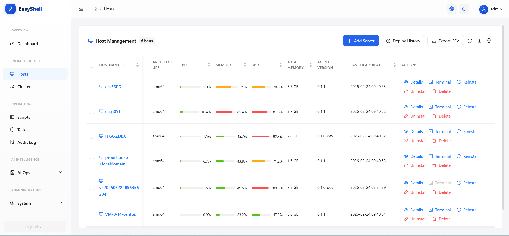
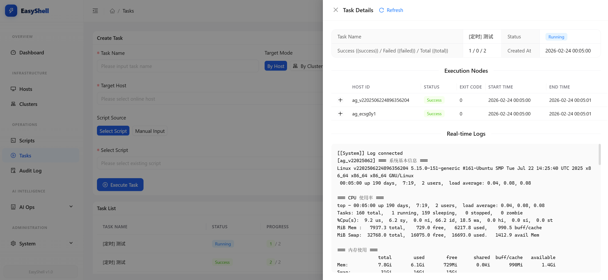
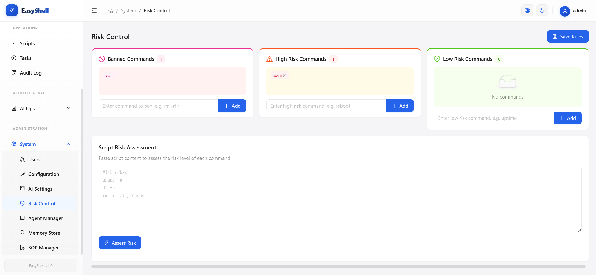
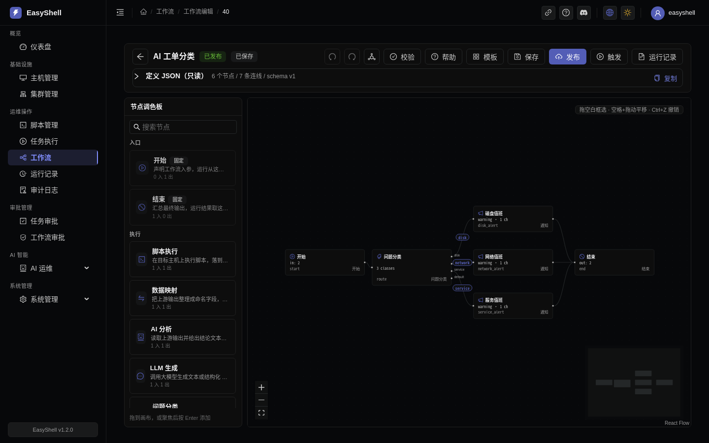
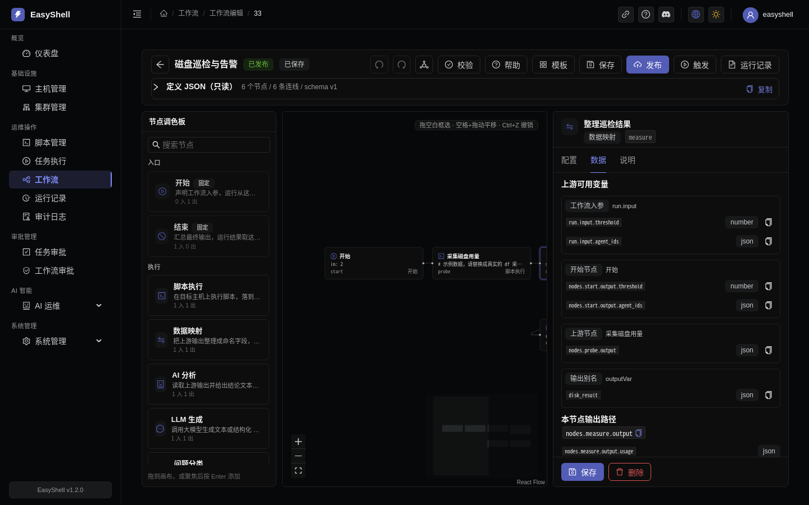
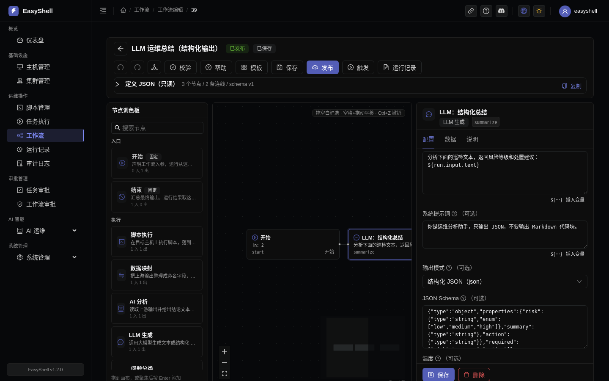

<p align="center">
  
</p>

# EasyShell

**AI 原生服务器运维平台**

让 AI 为你编写脚本、编排多机任务并分析基础设施 —— 而你只需关注核心决策。

[](./LICENSE)
[](https://docs.easyshell.ai)
[](https://discord.gg/akQqRgNB6t)

**语言**: [English](./README.md) | 简体中文 | [繁體中文](./README.zh-TW.md) | [한국어](./README.ko.md) | [Русский](./README.ru.md) | [日本語](./README.ja.md)

---

## 为什么选择 EasyShell？

传统的服务器管理工具需要你亲手编写每个脚本、登录每台机器并自行解读输出结果。EasyShell 颠覆了这一模式：**AI 是执行者，你是决策者。**

- **用自然语言描述需求** → AI 编写生产级 Shell 脚本，并支持差异比对预览
- **设定跨多机目标** → AI 规划执行步骤、运行任务并汇总分析结果
- **配置定时巡检任务** → AI 分析输出结果并自主决策是否通过机器人频道告警通知团队
- **通过 Web SSH 连接** → 全功能终端，集成文件管理器、多标签页及搜索 —— 无需本地客户端

---

## 核心功能

### 1. AI 脚本助手

> 描述你的需求。AI 编写脚本。查看差异比对。一键应用执行。

AI 脚本工作台是一个双栏编辑器，你只需用自然语言描述需求，AI 即可针对目标操作系统生成（或修改）Shell 脚本。支持实时流式输出，内置差异比对视图（Diff View）精准定位改动，并提供中文摘要解释修改内容。

<p align="center">
  
</p>

**工作流程：**
1. **描述** —— 用自然语言描述需求，选择目标操作系统
2. **生成** —— AI 实时流式生成生产级脚本
3. **审查** —— 内置差异比对视图高亮显示所有变更；摘要标签解释修改内容
4. **应用** —— 一键保存至脚本库或立即下发执行

### 2. AI 任务编排

> “检查所有主机的磁盘和内存，标记占用超过 80% 的项，并给出修复建议。” —— 已完成。

AI 对话界面允许你下达高层级的运维目标。AI 会将其拆解为多步执行计划（探索 → 分析 → 报告），将脚本分发至目标主机，收集执行结果，并在单次对话中交付包含风险评估和操作建议的结构化分析报告。

<p align="center">
  
</p>

**工作流程：**
1. **指令** —— 在 AI 对话中描述高层级运维目标（如「检查所有主机磁盘使用率」）
2. **规划** —— AI 将目标拆解为多步执行计划（探索 → 分析 → 报告）
3. **执行** —— 脚本并行分发至目标主机，结果自动收集
4. **报告** —— AI 生成包含风险评估和操作建议的结构化分析报告

### 3. AI 定时巡检

> **定时任务 → 脚本执行 → AI 智能分析 → 智能告警** —— AI 分析输出结果并自主决策是否告警。

通过 Cron 表达式安排巡检任务，并从内置脚本库中选择脚本。EasyShell 按计划将脚本分发至 Agent，收集输出内容（磁盘、内存、服务、日志），交由 AI 模型进行智能分析，**由 AI 判断是否需要告警** —— 只在真正需要关注时才推送通知。

<p align="center">
  
</p>

**工作流程：**
1. **配置** —— Cron 表达式 + 脚本（从脚本库选择或自定义）+ AI 分析提示词 + 通知规则
2. **执行** —— EasyShell 按计划将脚本分发到目标 Agent
3. **分析** —— 输出发送到 AI 模型（OpenAI / Gemini / GitHub Copilot / 自定义）进行智能分析
4. **通知** —— AI 评估严重程度，在需要时通过机器人频道推送告警

**通知模式：** 始终推送、失败时推送、警告时推送、或 **AI 自主决策** —— AI 模型评估输出内容并自主判断是否需要告警。

**支持的机器人频道** ([配置指南](https://docs.easyshell.ai/configuration/bot-channels/)):

| 机器人 | 状态 |
|-----|--------|
| [Telegram](https://docs.easyshell.ai/configuration/bot-channels/) | ✅ 已支持 |
| [Discord](https://docs.easyshell.ai/configuration/bot-channels/) | ✅ 已支持 |
| [Slack](https://docs.easyshell.ai/configuration/bot-channels/) | ✅ 已支持 |
| [钉钉 (DingTalk)](https://docs.easyshell.ai/configuration/bot-channels/) | ✅ 已支持 |
| [飞书 (Feishu)](https://docs.easyshell.ai/configuration/bot-channels/) | ✅ 已支持 |
| [企业微信 (WeCom)](https://docs.easyshell.ai/configuration/bot-channels/) | ✅ 已支持 |

### 4. 全功能 Web SSH

> 真正的终端。真正的文件管理器。无需安装 SSH 客户端。

生产级的 Web 终端，支持多标签会话、集成式文件管理器（上传、下载、创建、删除、导航）、终端回滚缓冲区全文本搜索，并通过 WebSocket 保持长连接。让你在运行命令的同时高效管理文件。

<p align="center">
  
</p>

### 5. 主机管理与监控

> 统一视图展示所有服务器的实时状态，支持批量操作和 Agent 生命周期管理。

单独或批量管理主机 —— 通过表单或 CSV 导入添加、按集群组织、监控连接状态，一键部署/升级 Agent。统一仪表板让健康指标一目了然。

<p align="center">
  
</p>

### 6. 实时流式日志

> 实时观察脚本在所有目标主机上的执行过程。

当你下发脚本时，EasyShell 会从每个 Agent 实时流式传输输出内容。彩色日志、时间戳和按主机筛选功能，让你能即时发现问题 —— 无需再等待批处理任务完成。

<p align="center">
  
</p>

### 7. 安全与风控

> 内置安全机制：审批流程、审计追踪和操作限制。

配置哪些操作在执行前需要审批。所有操作都会被记录以满足合规要求。基于角色的访问控制限制「谁可以做什么」，敏感命令可以被标记或完全禁止。

<p align="center">
  
</p>

### 8. MCP 服务器与 AI 技能

> 让 AI 客户端直接运维你的基础设施 —— 与 Web 控制台共用同一套风险引擎、审批流程与审计日志。

EasyShell 提供两个配套组件，把平台能力装进你的 AI 助手：

- **`easyshell-mcp`** —— 一个 [Model Context Protocol](https://modelcontextprotocol.io) 服务器，把 EasyShell 的主机、脚本、任务与巡检能力以 MCP **工具**形式暴露出来，让 Claude Desktop、Claude Code、Cursor、Cherry Studio 等 MCP 客户端可以直接驱动 EasyShell。
- **`easyshell-skill`** —— 一份 `SKILL.md` 定义，告诉 AI 助手**何时**以及**如何**使用 EasyShell（核心工作流、完整工具目录、安全模型），适用于支持技能（skills）的助手。

#### `easyshell-mcp` —— 把 EasyShell 变成 MCP 工具

发布在 npm 上：[`@easyshell/mcp-server`](https://www.npmjs.com/package/@easyshell/mcp-server)，并已收录至 [MCP Registry](https://registry.modelcontextprotocol.io/servers/io.github.easyshell/mcp-server) 与 [Smithery](https://smithery.ai/server/@easyshell/mcp-server)。它通过 EasyShell REST API 通信，只需三个环境变量：

| 变量 | 必填 | 说明 |
|---|---|---|
| `EASYSHELL_URL` | 是 | EasyShell 服务器 API 地址（例如 `http://localhost:18080`）。 |
| `EASYSHELL_USER` | 是 | EasyShell 用户名。 |
| `EASYSHELL_PASS` | 是 | EasyShell 密码。 |

**工作流程：**
1. **运行** —— `npx -y @easyshell/mcp-server`，Node.js `>=18` 即可，无需构建
2. **连接** —— 用上面三个变量指向你的 EasyShell 服务器
3. **认证** —— 它会登录 EasyShell API，并在后续所有工具调用中复用该会话
4. **操作** —— AI 客户端调用 EasyShell 工具；风险分级、审批流程与审计日志依然全部生效

**stdio（默认）—— Claude Desktop / Claude Code / Cursor / Cherry Studio**

```json
{
  "mcpServers": {
    "easyshell": {
      "command": "npx",
      "args": ["-y", "@easyshell/mcp-server"],
      "env": {
        "EASYSHELL_URL": "http://localhost:18080",
        "EASYSHELL_USER": "easyshell",
        "EASYSHELL_PASS": "easyshell@changeme"
      }
    }
  }
}
```

> 请替换为你自己的账号。采用零配置 Docker 部署时，初始管理员密码为随机生成，并只在服务端日志中打印一次（`docker logs easyshell-server | grep 'initial admin password'`）。

不想手动改配置文件？自动安装器会识别 OpenCode、Cursor 或 Claude Desktop 并代为写入配置块 —— 由于文件包含密码，生成时会设置为 `0600` 权限：

```bash
MCP_PASSWORD='your-password' npx @easyshell/mcp-server --install
# 可选：--url http://your-server:18080 --user easyshell
```

> 推荐使用 `MCP_PASSWORD` 而非 `--pass`：命令行参数会出现在 `ps` 输出中。

**HTTP（SSE + Streamable HTTP）—— 远程或共享部署**

```bash
# 仅监听本机回环，无需令牌
npx -y @easyshell/mcp-server --port 3000

# 需要被其他机器访问时，必须提供 bearer 令牌
MCP_AUTH_TOKEN='choose-a-strong-token' \
  npx -y @easyshell/mcp-server --port 3000 --host 0.0.0.0 --allow-remote
```

| 端点 | 方法 | 协议 |
|---|---|---|
| `/mcp` | POST / GET / DELETE | Streamable HTTP (2025-03-26) |
| `/sse` | GET | 旧版 SSE (2024-11-05) |
| `/messages?sessionId=<id>` | POST | 旧版 SSE 消息处理 |
| `/health` | GET | 健康检查 |

支持 HTTP transport 的客户端指向 `http://<host>:3000/mcp`，并在请求头携带 `Authorization: Bearer <MCP_AUTH_TOKEN>`（具体配置字段名因客户端而异）：

```json
{
  "mcpServers": {
    "easyshell": {
      "type": "http",
      "url": "http://your-server:3000/mcp",
      "headers": { "Authorization": "Bearer <MCP_AUTH_TOKEN>" }
    }
  }
}
```

HTTP 模式会校验 `Host` 头以防御 DNS 重绑定攻击，CORS 仅放行 `--allowed-origin` 指定的来源，并对会话数与请求体大小做了上限限制。

**工具能力 —— 3 个层级共 20 个工具**

| 层级 | 工具 | 用途 |
|---|---|---|
| 核心层（6） | `list_hosts`、`get_host_detail`、`execute_script`、`get_task_detail`、`list_scripts`、`ai_chat` | 查找主机、执行脚本、读取结果、驱动 AI 编排 |
| 管理层（9） | `list_recent_tasks`、`create_script`、`list_clusters`、`get_cluster_detail`、`get_dashboard_stats`、`get_host_metrics`、`list_scheduled_tasks`、`trigger_inspection`、`get_inspect_reports` | 日常运维、监控与定时巡检 |
| 高级层（5） | `manage_tags`、`query_audit_logs`、`approve_task`、`send_notification`、`search_knowledge` | 治理能力：标签、审计、审批、通知、知识库 |

> [`easyshell-mcp/README.md`](./easyshell-mcp/README.md) 的工具表标注为 19 个，而源码实际注册了 20 个 —— `get_cluster_detail` 遗漏在该表中。上表与 `easyshell-mcp/src/tools/` 保持一致。

#### `easyshell-skill` —— 教会助手 EasyShell 的工作流

`easyshell-skill/SKILL.md` 是一份与助手无关的技能定义（含 name、description、compatibility、tags 等元信息），告诉 AI 助手何时启用 EasyShell 以及应遵循哪些工作流 —— 在多机执行脚本、AI 任务编排、安排巡检、监控基础设施 —— 以及绝不可绕过的安全模型。

手动安装或使用 `mdskills` CLI：

```bash
npx mdskills install easyshell
```

| 助手 | 技能路径 |
|---|---|
| OpenCode | `.opencode/skills/easyshell/SKILL.md` |
| Claude Code | `.claude/skills/easyshell/SKILL.md` |
| Cursor | `.cursor/skills/easyshell/SKILL.md` |
| VS Code Copilot | `.github/skills/easyshell/SKILL.md` |

该技能附带 `resources/tool-catalog.md`（每个工具的参数与示例）、`resources/deployment-guide.md` 与 `resources/troubleshooting.md`。技能可单独使用，但**技能 + MCP 服务器**才是预期组合：技能决定*做什么*，MCP 服务器提供*做事的工具*。

#### 当前边界 —— 规划方案前请先读这段

`easyshell-mcp` 是一个**出口**：它让 EasyShell 能被 AI 客户端*调用*。而在 EasyShell 平台**内部消费外部 MCP 服务器**（Prometheus、Elasticsearch 或你自建的 MCP）**仍在路线图上，1.1.0 尚未实现**。目前没有内置 MCP 客户端、没有外部工具注册表、也没有外部工具审批流，本节内容不应被理解为对此的任何承诺。

如果这正是你的场景，欢迎到 [issue #6](https://github.com/easyshell-ai/easyshell/issues/6)（「mcp 和skill模块是怎么玩的呢？」）补充讨论，或提交功能建议。

### 9. 工作流引擎

> 把运维手册拖到画布上。让节点之间传值。在任何有破坏性的步骤前放一道人工闸门。

工作流引擎把一串运维步骤变成**可视化、带版本、可审计**的工作流。它不是「又一个脚本执行器」：
画布上的每个节点只做一件事，输入从上游来、输出给下游用；开始节点声明这次运行需要什么参数，
结束节点声明这次运行最终产出什么。运行时走的是和脚本下发完全相同的派发、风险门禁、审计与
日志链路。

<p align="center">
  
</p>

#### 一条工作流长什么样

```
开始 ──> 采集磁盘用量 ──> 整理结果 ──> 超过阈值？ ──IF──> 发送告警 ──> 结束
                                          └────────ELSE──────────────┘
```

- **开始**：声明入参（名称、类型、是否必填、默认值、说明）。触发弹窗按这些声明自动生成表单。
- **脚本执行**：在指定 agent / 集群 / 标签上运行脚本，落到真实 Task。
- **数据映射**：把上游输出整理成命名变量，避免下游到处写长路径。
- **条件分支**：一个表达式，两个真实出口 `IF` / `ELSE`；只走命中的那一条。
- **AI 分析**：把上游输出交给平台已配置的模型做结论分析（**只分析，不执行命令**）。
- **人工审批**：挂起运行，等待管理员批准/拒绝；高危脚本的唯一合法放行通道。
- **通知**：推送到已配置的机器人渠道；推送失败会如实记录，不会谎报已送达。
- **等待**：按秒等待，取消不会被 sleep 卡住。
- **结束**：声明本次运行的最终输出字段，运行详情直接展示这份结果。

#### 十二类节点

| 节点 | 作用 | 输出（下游可引用） |
|------|------|------------------|
| `start` | 声明运行入参，工作流唯一入口 | 每个入参：`nodes.start.output.<name>` |
| `script-exec` | 在目标主机执行脚本，落到真实 Task | 脚本 stdout（文本或 JSON），整体引用 |
| `transform` | 数据映射 / 重命名 / 拼接 | `nodes.<key>.output.<name>` |
| `condition` | 表达式求值，IF / ELSE 双分支 | `nodes.<key>.output.result`（boolean） |
| `ai-analyze` | 读上游输出做运维语义分析 | `.text` / `.json` / `.structured` / `.truncated` |
| `llm` | 通用大模型：提示词 → 文本或结构化 JSON | `.text` / `.json` / `.structured` / `.model` |
| `classifier` | 问题分类器：按模型分类结果路由 | `.class` / `.reason` / `.raw` |
| `code` | JS / Python 数据变换（隔离沙箱） | 代码返回的 JSON 值 |
| `approval` | 挂起运行等待人工审批 | `.decision` / `.comment` / `.decidedBy` |
| `notify` | 推送消息到机器人渠道 | `.delivered` / `.failed` / `.skipped` |
| `wait` | 等待指定秒数 | `.waitedMs` |
| `end` | 声明工作流最终输出 | 运行详情的 `output` |

`approval` 还有一个 `mode: "human-confirm"` 配置变体——更轻的「仅确认」闸门，复用同一张审批行、
同一套挂起/恢复状态机，而不是另造第二套机制。

#### 节点之间如何传参（这次的重点）

编辑器里不需要背路径。所有模板、参数、映射、条件字段右侧都有**变量选择器**，按「工作流入参 /
上游节点 / 输出别名」分组，只列出当前节点真正能读到的祖先变量。选中即插入：

<p align="center">
  
</p>

- **模板字段**（脚本参数、通知模板、审批详情、数据映射、AI 输入、结束输出）用 `${路径}`：
  ```text
  磁盘 ${nodes.probe.output.mount} 使用率 ${nodes.probe.output.usage}%
  ```
- **表达式字段**（条件、边条件）用裸路径：
  ```text
  nodes.metrics.output.usage > run.input.threshold
  ```
- **脚本正文**仍用脚本库约定的 `{{NAME}}` 槽位，取值来自 parameters（值本身可以是 `${路径}`）。
  例：脚本写 `systemctl restart {{SERVICE}}`，参数 `SERVICE = ${run.input.service_name}`。

路径规则：

| 来源 | 写法 |
|---|---|
| 运行入参 | `run.input.<name>` |
| 开始节点输出 | `nodes.<startKey>.output.<name>` |
| 上游节点输出 | `nodes.<key>.output` / `nodes.<key>.output.<field>` |
| 输出别名 | `<outputVar>` / `<outputVar>.<field>`（与 `nodes.<key>.output` 等价） |

值只对该节点的**拓扑后继**可见；引用非祖先节点会在发布期报
`EXPRESSION_REFERENCE_NOT_ANCESTOR`，运行期也读不到。单值上限 8192 UTF-8 字节；超出则存头尾
preview 并带 `truncated` 与 warning。没有 secret 注入通道：凭据请留在主机自己的凭据管理里。


开始节点不是一堆原始 JSON：它用字段编辑器声明 `label`（显示名）、`name`（变量 key）、
`type`（string / number / boolean / json）、是否必填、默认值、说明；string 字段还可以维护
`options`，触发弹窗会把它渲染成下拉选择，而不是让用户手输。条件节点也提供
「变量 + 运算符 + 值」的结构化构建器，复杂表达式再切到高级手写模式。

#### 条件分支：IF / ELSE 是真实的门控

条件节点只有一个表达式，节点求值得到 `true` / `false`，两个出口分别接 `IF` 和 `ELSE`。
运行时引擎按上游节点的 `result` 决定哪条边走，另一条不通行；上游输出缺失时两条都不走
（fail-closed），绝不会「条件没求出来就默认放行」。边上的 `IF` / `ELSE` 标签在浅色与深色主题下
都可读，条件原文在节点配置里编辑。

#### AI 节点：文本、结构化 JSON 与分类路由

- `ai-analyze`：读上游运维输出，产出分析结论；支持 `text` 与结构化 `json` 两种输出模式。
- `llm`：通用大模型节点，可选 provider / model、系统提示词、用户提示词、温度；支持
  `text` 与结构化 `json`，JSON Schema 作为提示约束，解析失败会自动重试一次修复。
- `classifier`：Dify 风格问题分类器，配置 1–10 个 class（名称 + 描述），模型返回
  `{"class":"...","reason":"..."}`；每个 class 在画布上有一个真实出边把手，另有 `default`
  兜底。模型返回未知 class 时节点直接失败，绝不静默路由。

三类节点都复用平台「系统设置 → AI」的模型配置，不新建 AI 通道；输入/输出都过敏感信息脱敏。
它们**只产出文本/JSON/分类结果，不具备执行能力**：即使输出里写了 `rm -rf`，也不会获得派发授权。
要让 AI 的结论变成操作，必须由人写成脚本，并经过 `approval` 节点与风险门禁；LLM/AI 输出也
禁止直接作为脚本的 `raw` 参数。

<p align="center">
  
</p>

明确不做：AI Agent 自主调工具、AI 生成脚本直接执行。`CommandRiskEngine` 是模式匹配，语义
层面的提示注入不能靠它单独兜底。

#### 代码节点：数据变换沙箱，不是主机执行器

`code` 节点支持 JavaScript / Python，用来做字段提取、格式转换、拼接等数据变换：

```javascript
function main(input) {
  return { total: Number(input.a) + Number(input.b) };
}
```

```python
def main(input):
    return {"total": float(input["a"]) + float(input["b"])}
```

- 输入通过 `inputs` 映射声明，值可以是上游变量；代码在 **GraalVM Polyglot 沙箱**中执行：
  无宿主对象、无文件/网络/环境变量/进程/线程访问，超时强制关闭上下文。
- 返回值必须是 JSON 可序列化类型，写入 `nodes.<key>.output`。
- 它不操作服务器。要在主机上执行命令，仍然使用 `script-exec` + agent。

#### 失败策略

每条边（以及整个 definition）可选择上游失败时下游节点怎么办：

| 策略 | 效果 |
|------|------|
| `abort` | 本节点及全部未开始节点被取消，run 终态 `failed` |
| `skip`（默认） | 本节点标记 `skipped`，其下游再按各自策略判断 |
| `partial` | 上游失败也执行本节点，失败的上游 output 视为不存在 |

多条入边策略不一致时**取最严格**（`abort > skip > partial`）。无法识别的策略一律按 `abort`
处理 —— 失败方向是闭合的，永远不会是放开的。

#### 编辑器

- 左侧节点库按「入口 / 执行 / 流程 / 人工」分组，带一句话说明与搜索。
- 中间画布自适应高度；节点卡片直接显示类型、输入输出摘要、输出变量与运行状态。
- 右侧检查器分「配置 / 数据 / 说明」三页：配置字段、当前节点能读到的上游变量、节点用途与示例。
- 顶栏「帮助」有 4 步入门、变量语法、节点速查与完整示例；「模板」提供磁盘巡检、服务重启审批、
  批量健康检查三个可直接改的起点。
- 画布完整支持框选、对齐吸附、撤销/重做、小地图、自动布局、复制/粘贴、快捷键；连线在客户端
  先校验（不自连、不重复、不成环、开始不能有入边、结束不能有出边），服务端仍是权威。

#### 运行监控与审计

运行详情页是一张按实际发生情况着色的只读画布，旁边是节点表格。点节点可查看输入、输出、错误、
attempt、关联 Task，并对该节点做一次**试运行**（不重跑整条工作流）。结束节点声明的输出直接
显示在「运行输出」里。

每次运行都记录到足以还原「发生了什么、为什么」：不可变的定义版本及其 SHA-256、完整入参快照、
每节点的输入与输出及指纹、attempt 序号、Task id、派发时的 agent 版本、以及 run 启动时生效的
风险规则快照。五类高危事件（发布、批准、拒绝、触发、取消）同步写审计，审计写失败即使业务失败。

#### 当前边界

2.1 交付的是「开始/结束契约 + 十二类节点 + 变量选择器 + IF/ELSE 真实门控 + LLM/结构化输出 +
问题分类器 + JS/Python 数据沙箱 + 运行试运行」。
以下仍**未实现**，规划前请先看：cron / webhook 触发器、HTTP 请求节点、并行 fan-out/fan-in、
子工作流、循环、artifact 存储、secret 注入、dry-run / replay、跨实例调度。单节点试运行已在运行
详情页接入，但它只适用于已经存在的 run。

完整上手流程见[《Workflow 从 0 到 1》](https://docs.easyshell.ai/guides/workflow/)，缺失的功能
欢迎提交建议。

---

## 快速开始

```bash
git clone https://github.com/easyshell-ai/easyshell.git
cd easyshell
docker compose up -d
```

以上就是全部步骤 —— **不需要 `.env`、不需要生成密钥、不需要任何手动配置**。首次启动时一个一次性容器会
生成数据库密码、JWT 密钥、加密密钥和 agent 注册密钥，存入 `easyshell_secrets` 数据卷，之后每次启动都复用同一份。

`scripts/deploy.sh` 是可选封装，额外等待健康检查通过并打印登录信息：

```bash
./scripts/deploy.sh            # docker compose up -d + 等待就绪 + 显示登录方式
./scripts/deploy.sh --build    # 用当前源码构建镜像后启动（而非拉取预构建镜像）
./scripts/deploy.sh --down     # 停止全部组件（保留数据卷）
```

默认路径无需本地构建 —— 预构建镜像将自动从 [Docker Hub](https://hub.docker.com/u/laolupaojiao) 拉取；
如需运行当前源码（包含尚未发布的安全修复），请使用 `--build`。

访问 `http://localhost:18880` → 使用 `easyshell` 登录。初始密码在首次启动时随机生成，并在服务端日志中打印一次
（`docker logs easyshell-server | grep 'initial admin password'`），登录后请立即修改；也可在 `.env` 中设置
`EASYSHELL_ADMIN_PASSWORD` 自行指定。

部署到其他机器上的 agent 需要一个可达的服务器地址：在 `.env` 中设置 `PROVISION_SERVER_URL`，
或在 UI 的「系统管理 → 系统配置」中设置 `server.external-url`。

> **想使用 GHCR？** 在 `.env` 中设置：
> ```
> EASYSHELL_SERVER_IMAGE=ghcr.io/easyshell-ai/easyshell/easyshell-server:latest
> EASYSHELL_WEB_IMAGE=ghcr.io/easyshell-ai/easyshell/easyshell-web:latest
> ```

> **开发者？从源码构建：**
> ```bash
> docker compose -f docker-compose.build.yml up -d
> ```

---

## 完整功能集

| 类别 | 功能特性 |
|----------|----------|
| **AI 智能** | AI 脚本助手（生成 / 修改 / 差异比对 / 摘要）、AI 任务编排（多步计划、并行执行、深度分析）、AI 定时巡检（Cron 定时、AI 输出分析、智能告警决策、多频道机器人推送）、AI 对话、巡检报告、操作审批 |
| **运维操作** | 脚本库、批量执行、实时流式日志、集成文件管理器的 Web SSH 终端、**工作流引擎**（可视化 DAG 画布、节点传参、失败策略、人工审批、运行监控） |
| **基础设施** | 主机管理、实时监控、集群分组、Agent 自动部署 |
| **系统管理** | 用户管理、系统配置、AI 模型设置（OpenAI / Gemini / Copilot / 自定义）、风险控制 |
| **平台特性** | 国际化（中/英）、深色/浅色主题、响应式设计、审计日志 |

---

## 架构

```
┌──────────────┐       HTTP/WS        ┌──────────────────┐
│  EasyShell   │◄─────────────────────►│   EasyShell      │
│    Agent     │  register / heartbeat │     Server       │
│  (Go 1.24)  │  script exec / logs   │ (Spring Boot 3.5)│
└──────────────┘                       └────────┬─────────┘
                                                │
                                       ┌────────┴─────────┐
                                       │   EasyShell Web   │
                                       │ (React + Ant Design)│
                                       └──────────────────┘
```

## 技术栈

| 组件 | 技术 |
|-----------|-----------|
| Server | Java 17, Spring Boot 3.5, Gradle, JPA/Hibernate, Spring AI, Spring Security |
| Agent | Go 1.24, 单一二进制文件, 零运行时依赖 |
| Web | React 19, TypeScript, Vite 7, Ant Design 6 |
| Database | MySQL 8.0 |
| Cache | Redis 7 |

## 项目结构

```
easyshell/
├── easyshell-server/           # 中央管理服务器 (Java / Spring Boot)
├── easyshell-agent/            # Agent 客户端 (Go, 单一二进制文件)
├── easyshell-web/              # Web 前端 (React + Ant Design)
├── easyshell-mcp/              # MCP 服务器 —— 把 EasyShell 暴露为 AI 客户端工具 (npm: @easyshell/mcp-server)
├── easyshell-skill/            # 面向 AI 助手的 SKILL.md 定义
├── docker-compose.yml          # 生产环境部署 (拉取预构建镜像)
├── docker-compose.build.yml    # 开发环境部署 (从源码本地构建)
├── Dockerfile.server           # Server + Agent 多阶段构建
├── Dockerfile.web              # Web 前端多阶段构建
├── .github/workflows/          # CI/CD: 构建与发布 Docker 镜像
└── .env.example                # 环境变量配置模板
```

## 文档

访问 **[docs.easyshell.ai](https://docs.easyshell.ai)** 获取：

- 安装与部署指南
- 快速入门指引
- 配置参考
- 开发指南

## 社区

[](https://discord.gg/akQqRgNB6t)

加入我们的 Discord 社区获取支持、参与讨论并获取更新动态：
**[https://discord.gg/akQqRgNB6t](https://discord.gg/akQqRgNB6t)**

## 许可证

本项目采用 [MIT 许可证](./LICENSE) 开源。
